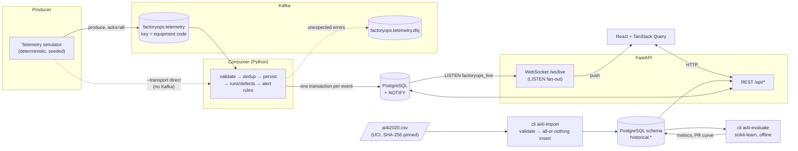
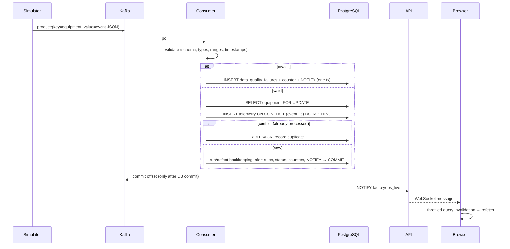
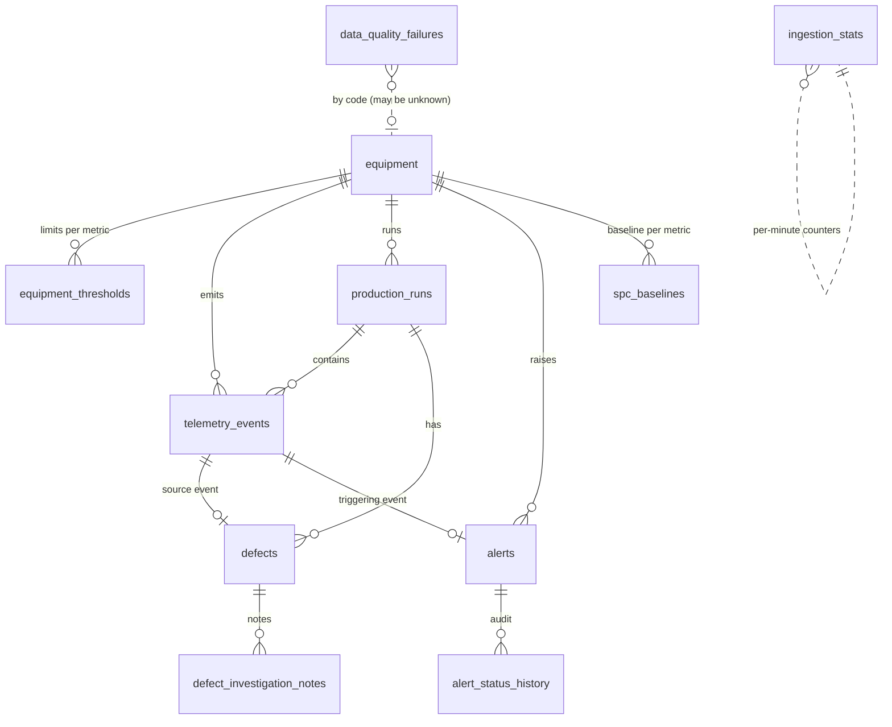

# FactoryOps

**A full-stack manufacturing operations & quality intelligence platform: live equipment monitoring plus a reproducible failure analysis on a public predictive-maintenance benchmark.**

## The problem

On a production line, unplanned equipment failures scrap parts and stop the line. Operations engineers need three things, and FactoryOps implements all three end to end:

1. **Trustworthy live signals.** Ingest machine telemetry, reject bad data with a reason instead of silently dropping it, never double-count a redelivered event, and raise alerts that explain themselves.
2. **An investigation workflow.** When a defect or alert appears, show the evidence (readings, thresholds, overlapping alerts) and record who did what. No automated root-cause claims.
3. **Evidence about which operating conditions precede failure.** Then measure, honestly, how well a failure can be flagged from process measurements alone. This uses the **UCI AI4I 2020 Predictive Maintenance Dataset**, a documented benchmark that is kept strictly separate from live telemetry.

FactoryOps ingests telemetry from 15 simulated machines through Kafka, validates and de-duplicates every event, stores it in PostgreSQL, raises threshold and Shewhart SPC alerts, tracks production runs and defects, and pushes live updates to React over WebSockets. Separately, it imports the AI4I 2020 CSV into its own `historical` schema, with provenance, validation and idempotency, and serves failure analysis and offline model evaluation.

## FactoryOps Demo

<p align="center">
  
</p>

<p align="center">
  <em>Live manufacturing telemetry, equipment monitoring, and predictive maintenance.</em>
</p>

<p align="center">
  <a href="Screen%20Recording%20factoryops.mov">Watch the full original recording (MOV)</a>
</p>

> **Data honesty.** The live plant (equipment, telemetry, defects, thresholds) is **simulated**. The historical benchmark is the public UCI AI4I 2020 dataset, which UCI itself describes as **synthetic** ("a synthetic dataset that reflects real predictive maintenance data encountered in industry"). Neither is data from Tesla or any other manufacturer, and no result here demonstrates real factory performance.

---

## Contents

- [Features](#features)
- [Architecture](#architecture)
- [Quick start](#quick-start)
- [Running tests](#running-tests)
- [Event lifecycle](#event-lifecycle)
- [Data quality & idempotency design](#data-quality--idempotency-design)
- [Alerting & statistical monitoring](#alerting--statistical-monitoring)
- [Database schema](#database-schema)
- [API](#api)
- [Historical benchmark: AI4I 2020](#historical-benchmark-ai4i-2020)
- [Incident: consumer rejected 100% of events](#incident-consumer-rejected-100-of-events)
- [Synthetic scenarios](#synthetic-scenarios)
- [Technology choices](#technology-choices)
- [Known limitations](#known-limitations)
- [Future improvements](#future-improvements)

## Features

| Area | What works |
|---|---|
| **Operations overview** | KPI cards (equipment, running, warning/critical, units, defect rate, rejected events) from SQL aggregations. Also: status distribution, telemetry trends for 1h/6h/24h/7d, defect rate by station, recent alerts and runs, ingestion stats, and a live event feed. |
| **Equipment** | Full CRUD with per-metric warning/critical thresholds. Search (debounced), status/station filters, sorting, pagination, field-level validation, soft-delete with confirmation and reactivation. The detail page shows the latest reading, a trend with threshold lines, a control chart, alert history and related runs. |
| **Production runs** | Searchable, paginated table with status/station/date-range filters. The detail panel shows the yield and defect-rate arithmetic and run telemetry stats. |
| **Quality & defects** | Investigation workflow: status transitions are enforced server-side, and resolving or dismissing requires a note. Timestamped notes, plus evidence: the source telemetry event, ±15 min of readings against thresholds, and overlapping alerts. Aggregations by category, station and severity. No automated root-cause claims. |
| **Alerts** | Threshold and SPC alerts that explain why they fired. Acknowledge/resolve runs under row locks, with an audit history. A dedup and cooldown policy prevents alert storms. |
| **Data quality** | Every received message is accounted for: accepted, accepted-late, rejected (with category, field and human-readable reason), or duplicate. Includes outcome-over-time charts and a paginated inspection table with sanitized payload excerpts. |
| **Settings** | Per-browser display preferences (timezone, density, default range), live/polling refresh behavior, demo scenario injection, SPC baseline recompute, and read-only server policy. |
| **Historical analysis** | AI4I 2020 import with source attribution, SHA-256 identity, all-or-nothing validation and row counts. Failure rate by operating condition (raw and derived variables). Documented failure rules checked against the labels. Offline failure-prediction evaluation (precision, recall, PR-AUC, confusion matrix, PR curves, per-mode recall, permutation importance). Searchable records. |
| **Live updates** | Postgres `NOTIFY` → API `LISTEN` → WebSocket fan-out. The client reconnects with bounded exponential backoff and refetches stale data after reconnecting, with polling as a fallback. |

## Architecture



Key decisions:

- **One processing function, two transports.** `pipeline/processor.py::process_message` holds all ingestion logic. The Kafka consumer and the `direct` transport (used by seeding, the demo endpoint, and environments without Kafka) both call it, so tests exercise the same code that production runs.
- **Live updates through Postgres `NOTIFY`.** Notifications are transactional: the UI never sees an alert or defect that was rolled back. No Redis or extra broker is needed.
- **A modular monolith, not microservices.** There are three processes (API, consumer, simulator) sharing one Python package.
- **Historical data is physically separate.** Benchmark rows live in the Postgres schema `historical`. No live table references it, `seed --reset` never touches it, and the API serves it under `/api/historical/*`. Model training is an offline CLI step; the API only reads stored results, so request handling never loads scikit-learn models.

## Quick start

### Option A: Docker Compose (full stack with Kafka)

```bash
cp .env.example .env            # set POSTGRES_PASSWORD
docker compose up --build       # postgres, kafka (KRaft), topic init, migrate, fleet-init, api, consumer, simulator, frontend
docker compose run --rm api python -m factoryops.cli seed --reset --hours 6   # optional history backfill
```

Open **http://localhost:8080**. The API docs are at http://localhost:8000/docs.

The `simulator` service streams the `mixed` scenario forever. Change it with `SIM_SCENARIO` in `.env`.

Historical benchmark (one command; downloads from UCI, verifies the checksum, imports and evaluates):

```bash
docker compose run --rm api python -m factoryops.cli ai4i-setup
```

### Option B: Local without Docker (PostgreSQL 16 + uv + Node 20+)

```bash
make setup          # uv sync + npm ci
make db             # createdb factoryops && createdb factoryops_test
make migrate        # alembic upgrade head
make seed           # deterministic 6h backfill (~5.4k events through the real pipeline, ~30s)
make api            # terminal 1 → http://localhost:8000/docs
make frontend       # terminal 2 → http://localhost:5173 (proxies /api and /ws)
make simulate-direct  # terminal 3: live telemetry through the pipeline without Kafka
```

Historical benchmark, step by step:

```bash
cd backend
uv run python -m factoryops.cli ai4i-download --dest data      # fetch + verify SHA-256 (data/ is gitignored)
uv run python -m factoryops.cli ai4i-import --file data/ai4i2020.csv   # re-running is a no-op
uv run python -m factoryops.cli ai4i-evaluate --seed 42 --test-size 0.25
```

If you have a local Kafka on `localhost:29092`, use `make consumer` and `make simulate` instead of `simulate-direct`.

Configuration is environment-only: variables are prefixed `FACTORYOPS_` (see `backend/factoryops/config.py` and `.env.example`). The API never exposes secrets. `/api/settings/public` returns only non-secret policy values.

### Useful commands

```bash
cd backend
uv run alembic upgrade head                               # migrate
uv run alembic revision --autogenerate -m "..."           # new migration
uv run python -m factoryops.cli seed --reset --hours 6 --seed 42
uv run python -m factoryops.cli compute-baselines --hours 6
uv run python -m factoryops.simulator --transport kafka --scenario temperature_drift --ticks 120 --interval 1
uv run python -m factoryops.simulator --transport direct --scenario duplicates --ticks 20
uv run python -m factoryops.consumer
uv run python -m factoryops.cli replay-dlq --max 100      # re-publish DLQ messages after fixing a bug
```

## Running tests

```bash
./scripts/test.sh     # (= make test) ruff, pytest, eslint, tsc, vitest, vite build
```

The backend tests need PostgreSQL. They use `FACTORYOPS_TEST_DATABASE_URL` (default `postgresql+psycopg://localhost:5432/factoryops_test`) and refuse to run against any database whose name doesn't end in `_test`. The schema is rebuilt from the Alembic migrations at session start, and every table is truncated after each test, so they never touch your dev data.

| Suite (120 backend + 20 frontend) | Count | Covers |
|---|---|---|
| `backend/tests/test_validation.py` | 24 | Schema, missing fields, types, NaN/inf, plausible-range boundaries, timestamp rules, late flag, quality checks, payload sanitization |
| `backend/tests/test_rules_analytics.py` | 13 | Threshold boundaries (equal = no alert), low limits, SPC rule, rule precedence, yield/defect math, I-MR sigma estimate, Western Electric rules |
| `backend/tests/test_processor.py` | 14 | Persistence, **duplicate idempotency**, invalid → DQ record, unknown/inactive equipment, out-of-order and late events, **alert dedup + escalation + cooldown**, defects, run rollover, bounded retry, no retry on non-transient errors |
| `backend/tests/test_api_equipment.py` | 12 | CRUD, conflict, field validation, search/filter/sort/pagination, 404/422 |
| `backend/tests/test_api_workflows.py` | 9 | Alert ack/resolve + history + invalid transitions, defect investigation, runs, dashboard numbers, control chart, data-quality endpoints, readiness 503, DB-down 503, demo endpoint |
| `backend/tests/test_constraints_and_live.py` | 23 | DB CHECK/unique constraints, consumer + DLQ + transient handling, **fleet-registration regression + rejection-rate warning**, WebSocket envelope, slow-client queue bound, real `LISTEN/NOTIFY`, simulator determinism and scenarios |
| `backend/tests/test_historical.py` | 25 | AI4I header/row validation (types, bounds, flags, ID/type mismatch, duplicate UDI/Product ID, BOM), all-or-nothing import, provenance and generated columns, **re-import no-op**, conflicting file needs `--replace`, live reset leaves history intact, CLI error output, API before/after import, binning and rule checks, records filters, **leakage guard**, hand-computed precision/recall/AP, stratification, determinism, persistence |
| `frontend/src/lib/lib.test.ts` | 6 | Query building, error-envelope parsing, network failures, backoff bounds, **reconnect sequence with a fake socket** |
| `frontend/src/pages/pages.test.tsx` | 14 | Loading/success/empty/error states, debounced search + filters, equipment form validation & create, server conflict, alert acknowledgement, defect status + notes, KPI rendering, connection status, historical page (not-imported state; provenance, synthetic notice and metrics) |

## Event lifecycle



Each telemetry event (wire schema v1) looks like this:

```json
{
  "schema_version": 1,
  "event_id": "b111df39-1790-559b-bbf7-be57faa81539",
  "equipment_id": "WELD-02",
  "event_time": "2026-10-29T00:04:00Z",
  "machine_state": "running",
  "batch_id": "B202610290000",
  "metrics": { "temperature_c": 70.7, "vibration_mm_s": 2.3, "pressure_bar": 5.35, "cycle_time_s": 38.1 },
  "quality_check": { "result": "fail", "category": "weld", "severity": "major", "description": "..." }
}
```

Units: °C, mm/s RMS, bar, seconds. Each `running` event represents one completed cycle (one unit). A failed `quality_check` creates a defect linked to the run and the event.

## Data quality & idempotency design

| Situation | Handling |
|---|---|
| **Duplicate / redelivered event** | `event_id` is the `telemetry_events` primary key. The insert uses `ON CONFLICT DO NOTHING`. On conflict the whole transaction rolls back (so run counters are not double-counted), and the duplicate is recorded as a `duplicate` row and counter. The result is effectively-once storage on top of Kafka's at-least-once delivery. |
| **Late event** (received >120 s after `event_time`) | Stored with `is_late = true` and evaluated for alerts. It does **not** change current equipment status. |
| **Out-of-order event** (older than the equipment's latest event) | Same as late. Ordering is tracked per equipment via `equipment.last_event_at`, and the run start is moved earlier if needed. |
| **Future (>300 s skew) or too old (>7 days)** | Rejected: `invalid_timestamp`. Naive timestamps without a timezone are rejected too. |
| **Missing / wrong-type / malformed / non-finite** | Rejected with the exact field and reason. |
| **Physically impossible value** | Rejected as `out_of_range`. **Plausible ranges** (e.g. temperature −40…250 °C) are distinct from **operational alert thresholds** (per equipment, configurable, and required to lie inside the plausible range). |
| **Unknown or deactivated equipment** | Rejected: `unknown_equipment`. |
| **Transient DB error** | Retried with exponential backoff (0.5 s, 1 s, 2 s, …; 5 retries max). If retries are exhausted, the consumer exits **without committing the offset**, and Docker restarts it so the message is redelivered. |
| **Unexpected processing bug** | The raw message goes to the DLQ topic with `x-error`/`x-source` headers, a `processing_error` row is recorded, and the offset is committed. After a fix, `cli replay-dlq` re-publishes it. |
| **Invalid messages** | Recorded once and committed. They are never retried. |

**Payload safety.** Only known schema fields are persisted in `payload_excerpt`, with strings truncated to 64 characters. Unknown keys are listed **by name only**, so arbitrary content (for example a stray token) is never stored. For non-JSON payloads, only the byte length is kept.

**Counters.** `ingestion_stats` holds per-minute counts by outcome, maintained with an upsert in the same transaction. This is a deliberate denormalization: the dashboard reads a few hundred rows instead of scanning telemetry.

## Alerting & statistical monitoring

**Rules** (`pipeline/rules.py`, pure functions):

1. **Threshold**: critical limits are checked before warning limits. Alerts fire only on *strict* exceedance; a value equal to a limit is OK.
2. **SPC (Shewhart individuals chart, Western Electric rule 1)**: a running-state reading outside `mean ± 3σ` of the stored baseline. It applies only when no threshold rule fired for that metric.
3. **Machine fault**: `machine_state = fault` raises a critical alert.

**Dedup and cooldown policy:**

- At most **one unresolved alert per (equipment, metric, rule)**, enforced in the database by a partial unique index. Repeats increment `occurrence_count` and `last_seen_at`. If a repeat is critical while the alert is a warning, the alert escalates, and `observed_value`, `threshold_value`, `rule_detail` and `event_id` then describe the escalating event.
- After resolution, the same key is **suppressed for 300 s** (`FACTORYOPS_ALERT_COOLDOWN_SECONDS`).
- Each alert stores a human-readable `rule_detail` (e.g. `vibration 6.37 mm/s > critical limit 6.30 mm/s`), the triggering event, and a full status history (`alert_status_history`). Every state change runs in one transaction under `SELECT … FOR UPDATE`.

**Control chart method** (`analytics.py`):

- Center line = baseline mean. σ is estimated as **MR̄ / 1.128** (the average moving range of consecutive points ÷ d₂ for n = 2). This is the standard I-MR estimate and is less inflated by slow drift than the sample standard deviation.
- Limits = CL ± 3σ. Points are flagged by **WE-1** (beyond 3σ) and **WE-2** (8 consecutive points on one side).
- Baselines are computed from at least 20 running-state readings over a window **assumed to represent stable operation**. The seed uses the first 40 % of history, which is "normal" scenario only. They can be recomputed via the CLI or Settings. Without a stored baseline, the chart uses the first 25 points in view (a phase-I estimate) and says so.
- Expect false alarms. With individually tested points, an in-control process breaches 3σ about once per ~370 readings. Dedup keeps this to one open alert per key, but the SPC alerts on a synthetic stable process are *expected statistical noise*, not evidence of a fault.

## Database schema



- **Primary keys.** UUIDs everywhere. For telemetry, the producer-assigned `event_id` is the PK, which doubles as the idempotency key.
- **Timestamps.** All `timestamptz`. Sessions are pinned to UTC and the API returns `Z` timestamps.
- **Constraints.** Nonnegative counts, `defect_count <= units_produced`, `ended_at >= started_at`, enum CHECKs, warning ≤ critical ordering, one running run per equipment (partial unique index), and one active alert per key (partial unique index).
- **Indexes.** `(equipment_id, event_time)` and `event_time` on telemetry; `(status, triggered_at)` and `(equipment_id, triggered_at)` on alerts; `(equipment_id, started_at)` and `(status, started_at)` on runs; detection time/status on defects; `(category, received_at)` on failures.
- **Migrations.** All schema changes go through Alembic (`backend/alembic/versions`). The app never calls `create_all`. CI checks `alembic upgrade`, `alembic check` (no model drift) and `downgrade base`.
- **Historical schema.** `historical.dataset_imports` (provenance, SHA-256, row count, label observations), `historical.ai4i_records` (PK `(import_id, UDI)`, unique Product ID, CHECKs, generated derived columns), and `historical.model_evaluations`. No foreign keys connect it to live tables.
- **Soft delete.** Equipment `DELETE` deactivates the unit, so history stays referentially intact.

## API

Interactive docs are at **`/docs`** (OpenAPI). All list endpoints are paginated (`page`, `page_size ≤ 100`), filter in SQL, and bound time ranges (≤ 31 days). Errors share one envelope that includes the request ID, which is also returned in the `X-Request-ID` header and in the structured logs.

| Method | Path | Notes |
|---|---|---|
| GET/POST | `/api/equipment` | `q, status, station, include_inactive, sort=-code` |
| GET/PATCH/DELETE | `/api/equipment/{id}` | PATCH replaces thresholds if provided; DELETE = deactivate |
| GET | `/api/production-runs`, `/api/production-runs/{id}` | `q, status, equipment_id, station, start, end, sort` |
| GET/PATCH | `/api/defects`, `/api/defects/{id}` | detail includes notes + evidence |
| POST | `/api/defects/{id}/notes` | |
| GET | `/api/alerts`, `/api/alerts/{id}` | `status=open\|acknowledged\|resolved\|active` |
| POST | `/api/alerts/{id}/acknowledge`, `/resolve` | `{actor, note?}` |
| GET | `/api/telemetry`, `/api/telemetry/summary` | raw (limit ≤ 1000) / time-bucketed with `date_bin` |
| GET | `/api/dashboard/summary`, `/api/analytics/defects`, `/api/analytics/equipment`, `/api/analytics/control-chart` | calculation notes included |
| GET | `/api/data-quality/summary`, `/api/data-quality/failures` | |
| GET | `/api/health/live`, `/api/health/ready` | live = process up; ready = DB reachable + migrated (503 otherwise) |
| POST | `/api/demo/simulate`, `/api/demo/baselines` | only if `FACTORYOPS_DEMO_CONTROLS_ENABLED=true` |
| GET | `/api/historical/datasets`, `/summary`, `/failure-analysis`, `/failure-rules`, `/records`, `/model-evaluations` | historical benchmark (read-only); `/summary` → 404 with setup hint if not imported |
| WS | `/ws/live` | `{type, ts, data}`: `hello`, `heartbeat`, `telemetry`, `alert`, `defect`, `data_quality`, `equipment_status`, `lagged` |

**Example: acknowledge an alert** (real response, trimmed):

```bash
curl -X POST localhost:8000/api/alerts/8340fff0-.../acknowledge \
  -H 'Content-Type: application/json' -d '{"actor":"Dana (shift lead)","note":"Checking coolant flow"}'
```
```json
{
  "id": "8340fff0-bff0-4f23-87d3-45af698b6b1d",
  "equipment": { "code": "WELD-03", "name": "Body Weld Cell 3", "station": "Body Shop" },
  "metric": "vibration", "rule": "threshold_high",
  "rule_detail": "vibration 6.37 mm/s > critical limit 6.30 mm/s",
  "severity": "critical", "status": "acknowledged", "occurrence_count": 3,
  "history": [
    { "from_status": null,   "to_status": "open",         "actor": "system", "note": "vibration 3.99 mm/s > warning limit 3.96 mm/s" },
    { "from_status": "open", "to_status": "acknowledged", "actor": "Dana (shift lead)", "note": "Checking coolant flow" }
  ]
}
```

**Example: inspect a rejected event**

```bash
curl 'localhost:8000/api/data-quality/failures?category=out_of_range&page_size=1'
```
```json
{ "items": [{
    "event_id": "b111df39-1790-559b-bbf7-be57faa81539", "equipment_code": "WELD-02",
    "category": "out_of_range", "field": "metrics.vibration_mm_s",
    "reason": "vibration_mm_s=250.0 is outside the physically plausible range [0.0, 100.0]",
    "payload_excerpt": { "metrics": { "vibration_mm_s": 250.0, "...": "..." }, "machine_state": "running" },
    "source": "simulator:direct"
  }], "total": 11, "page": 1, "page_size": 1 }
```

**Example: validation error envelope**

```json
{ "error": {
    "code": "validation_error", "message": "Request validation failed",
    "details": [
      { "loc": ["body","code"], "msg": "String should match pattern '^[A-Z0-9][A-Z0-9-]{1,31}$'" },
      { "loc": ["body","thresholds","0"], "msg": "Value error, temperature: warning_high must be <= critical_high" }
    ],
    "request_id": "15f74e334fc044f694bc50a39f0307c9" } }
```

## Historical benchmark: AI4I 2020

### Provenance

| | |
|---|---|
| Dataset | AI4I 2020 Predictive Maintenance Dataset, [UCI ML Repository #601](https://archive.ics.uci.edu/dataset/601/ai4i+2020+predictive+maintenance+dataset) |
| Citation | Matzka, S. (2020). AI4I 2020 Predictive Maintenance Dataset. UCI Machine Learning Repository. https://doi.org/10.24432/C5HS5C |
| License | CC BY 4.0. The CSV is not committed; `ai4i-download` fetches it from UCI. |
| Nature | **Synthetic**, per UCI: it models a milling process with 10,000 data points. |
| File | `ai4i2020.csv` from the UCI zip, SHA-256 `dc6630cd9b1f0f853922fad78a1b6436570d3f1ec863f1dd5c4340ac56bc8a8e` (observed 2026-10-28). The downloader refuses a different hash unless `--allow-checksum-mismatch` is passed, and every import stores the hash of what it loaded. |
| Columns | `UDI`, `Product ID`, `Type` (L/M/H quality variant), `Air temperature [K]`, `Process temperature [K]`, `Rotational speed [rpm]`, `Torque [Nm]`, `Tool wear [min]`, `Machine failure`, `TWF`, `HDF`, `PWF`, `OSF`, `RNF` |

### Import pipeline

- **Validation is all-or-nothing.** The exact header (the published file starts with a UTF-8 BOM, which is handled) and every row are checked: positive integer `UDI`; `Product ID` like `L12345` whose letter matches `Type`; no duplicate UDI or Product ID; finite numbers within broad physical sanity bounds (not fitted to the data); integer speed and wear; flags exactly `0`/`1`. Any error rejects the whole file, reports up to 50 line-numbered errors, and writes nothing.
- **Idempotency.** A file is identified by its SHA-256. Re-importing the same file returns `unchanged` with 0 rows inserted. A *different* file is refused unless `--replace`, which swaps versions in one transaction; model evaluations of the old version are removed via cascade.
- **Row counts.** The import returns the rows in the file and rows inserted, and stores `row_count` with the provenance in `historical.dataset_imports`.
- **Derived columns.** Postgres computes the quantities named in the UCI description as generated columns: `temp_diff_k` (process − air), `power_w` (torque × rpm × 2π/60) and `strain_min_nm` (tool wear × torque).
- **Labels are never altered.** Inconsistencies are measured and shown instead. In the published file: **339** rows have `Machine failure = 1` (3.39 %); **9** failures carry no mode flag; **18** rows flag `RNF` while `Machine failure = 0`; **24** rows carry more than one mode. Note also that UCI's text says RNF occurs 5 times, but the file has 19 RNF flags.

### Failure analysis (from the imported file)

- **Failure rate by variable.** Equal-width bins are computed in SQL with `width_bucket`. For example, tool wear: bins below ~190 min sit around 1.6–2.7 %, while 189.8–210.8 min reaches 8.0 %, 210.8–231.9 min 17.8 %, and 231.9–253 min 31.4 % (12 bins).
- **By product type.** L 3.92 % (235/6000), M 2.77 % (83/2997), H 2.09 % (21/1003).
- **Documented rules vs labels**, checked by `/api/historical/failure-rules`:

| Mode | UCI-documented rule | Rule true | Labeled | Agree | Rule only | Label only |
|---|---|---|---|---|---|---|
| HDF | process − air < 8.6 K **and** speed < 1380 rpm | 115 | 115 | 115 | 0 | 0 |
| PWF | power < 3500 W **or** > 9000 W | 95 | 95 | 95 | 0 | 0 |
| OSF | wear × torque > 11000 / 12000 / 13000 min·Nm (L/M/H) | 98 | 98 | 98 | 0 | 0 |
| TWF | random replacement/failure at 200–240 min wear (not deterministic) | 790 | 46 | 43 | 747 | 3 |

**What this means.** In this synthetic dataset, three of five failure modes are *exact deterministic functions of the inputs*. That shapes the model results below.

### Failure prediction: evaluation protocol

- **Target:** `Machine failure`.
- **Inputs:** `Type` plus the five process measurements, nothing else.
- **Excluded to prevent leakage:** `TWF`, `HDF`, `PWF`, `OSF`, `RNF` (they define the target) and the identifiers `UDI` and `Product ID`. `assert_no_leakage` raises if any of them is passed as a feature, and the test suite checks this.
- **Split:** a single stratified `train_test_split`, seed 42, test size 0.25. That gives 7,500 train rows (254 failures) and 2,500 test rows (85 failures). All metrics come from the test set only.
- **Models** (scikit-learn 1.9.1, numpy 2.5.4):
  - Logistic regression: one-hot type, standardized inputs, `class_weight="balanced"`.
  - Histogram gradient boosting: type as categorical, default hyperparameters.
  - A **non-learned reference** that applies UCI's documented HDF/PWF/OSF rules.
- **Threshold:** 0.5 on predicted probability for precision, recall and the confusion matrix. PR-AUC is reported as average precision, which is threshold-free.
- **Reproduce:** `python -m factoryops.cli ai4i-evaluate --seed 42`. Repeated runs locally and in Docker produced identical output.

### Results (seed 42, held-out test set: 2,500 rows, 85 failures)

| Model | Precision | Recall | F1 | PR-AUC | TN | FP | FN | TP |
|---|---|---|---|---|---|---|---|---|
| Logistic regression | 0.139 | 0.800 | 0.237 | 0.383 | 1995 | 420 | 17 | 68 |
| Gradient boosting | 0.849 | 0.729 | 0.785 | 0.829 | 2404 | 11 | 23 | 62 |
| Documented rules (not trained) | 1.000 | 0.835 | 0.910 | n/a¹ | 2415 | 0 | 14 | 71 |

¹ The rule baseline outputs 0/1, so its average precision (0.841) is not comparable to a ranked score.

The no-skill PR-AUC baseline is the test prevalence, 0.034.

Test rows flagged per mode, detected at the 0.5 threshold:

| | HDF (36) | OSF (20) | PWF (17) | TWF (13) | RNF (6) |
|---|---|---|---|---|---|
| Logistic regression | 29 | 20 | 17 | 4 | 2 |
| Gradient boosting | 30 | 19 | 15 | 1 | 0 |
| Documented rules | 36 | 20 | 17 | 1 | 0 |

The RNF column counts *mode flags*. Some RNF-flagged rows have `Machine failure = 0` in the source file.

**Gradient boosting permutation importance** (mean drop in test PR-AUC over 5 shuffles): torque 0.580, air temperature 0.544, rotational speed 0.402, tool wear 0.329, process temperature 0.243, type 0.023.

**Interpretation, and what *not* to conclude**

- Gradient boosting reaches PR-AUC 0.83 largely because HDF, PWF and OSF are deterministic thresholds on the inputs. A tree model can learn them, and the hand-coded documented rules do as well or better. Strong scores here reflect the **synthetic generator**, not evidence that real equipment failures are this predictable.
- The linear model can't represent "temperature difference *and* low speed" or "power outside a band". Balanced weighting buys recall (0.80) at the cost of 420 false alarms.
- TWF and RNF are random in the generator, and every model largely misses them. That is the honest ceiling of this dataset.
- These are results from a single split. There is no cross-validation, no confidence intervals, no tuned threshold, and no temporal validation; the rows are not a time series of one machine. Treat them as a reproducible benchmark, not a deployable model.

## Incident: consumer rejected 100% of events

**Symptom.** The Docker consumer logged `"consumer progress", "processed": 500, "rejected": 500`, then 1000/1000, 1500/1500, and so on.

**Diagnosis.** I queried `data_quality_failures` in the running stack. The `equipment` table had **0 rows**, and **0** telemetry rows were stored. The rejections broke down as 1,988 `unknown_equipment` (`equipment 'WELD-01' is not registered or is deactivated`) plus 38 events rejected earlier, at validation, for the simulator's injected faults. The pipeline was behaving as designed, rejecting events from unregistered machines and recording why. The *deployment* was broken: the fleet was only created by the optional manual `cli seed` step, so the Compose simulator streamed telemetry for machines that didn't exist. The progress log made it worse by printing two equal numbers with no breakdown.

**Fix.**
1. Added an idempotent `python -m factoryops.cli register-fleet` command, which creates the 15 simulated units with no history and creates nothing on re-runs. A new one-shot `fleet-init` Compose service runs it after `migrate`, and the `consumer` and `simulator` services wait for it to complete.
2. Progress logs now report a per-window breakdown: accepted, rejected, duplicate, `rejection_rate`, and `rejected_by_category`. They escalate to **WARNING** when more than 50 % of a window is rejected, naming the top causes and, for `unknown_equipment`, the command to run. Duplicates are no longer mixed into the rejection categories.
3. Regression tests: rejection before registration and acceptance after it, idempotent registration, and the warning content.

**Verified on the running Kafka stack after the fix.** The first 500-message window logged `accepted 488, rejected 6 (missing_field 4, out_of_range 2), duplicate 6, rejection_rate 0.012`. All 3,263 `unknown_equipment` rejections in the database predate fleet registration; there have been none since.

## Synthetic scenarios

`python -m factoryops.simulator --scenario <name>`, or **Settings → Demo data** in the UI. Each scenario targets two units, chosen deterministically from the seed or set via `--targets`.

| Scenario | What happens | What to look for |
|---|---|---|
| `normal` | Gaussian noise around nominal values; ~1.5 % defect rate | Quiet dashboard |
| `temperature_drift` | +0.9 °C per tick on targets, resetting every 60 ticks (cool-down) so endless runs stay plausible | Warning → critical escalation; control chart departs from CL |
| `vibration_spike` | 2.6–4× vibration bursts | Threshold alerts with occurrence counts |
| `shutdown` | `fault` then `stopped` | Machine-fault critical alert, equipment → offline |
| `out_of_range` | 999 °C, −4 bar, 250 mm/s | `out_of_range` rejections |
| `missing_fields` | Drops `event_time`, `batch_id`, `machine_state`, or a metric | `missing_field` rejections |
| `duplicates` | Re-sends earlier messages | Duplicate count rises; telemetry count does not |
| `out_of_order` | Holds messages back and releases them later | `accepted_late` events |
| `defects` | 25 % inspection failures on targets | Defect rate by station; new defects to investigate |
| `mixed` | Low rates of all of the above | — |

Generation is deterministic. The same `--seed` and start time produce byte-identical messages, including `event_id`s, so **replaying a seeded run demonstrates idempotency**: every replayed event is counted as a duplicate.

## Technology choices

| Choice | Why | Trade-off |
|---|---|---|
| FastAPI + Pydantic v2 + SQLAlchemy 2 (sync) + psycopg 3 | Explicit schemas give OpenAPI for free; sync sessions keep transactions and row locks straightforward | Sync handlers run in a threadpool; fine at this scale |
| PostgreSQL `NOTIFY` for live updates | Transactional, no extra infrastructure | 8 kB payload limit (messages are small); one LISTEN connection per API process |
| confluent-kafka (librdkafka) | Maintained, idempotent producer, manual commits | C extension (wheels available) |
| Kafka in KRaft mode (`apache/kafka:3.9.0`) | No ZooKeeper | Single broker, RF = 1: a dev setup only |
| React 19, Vite 7, TS 5.9 strict, Tailwind 4, TanStack Query 5, Recharts 3, RHF + Zod 4, Vitest 3, ESLint 9 | Current stable majors with mature ecosystem support | Picked over the newer TS 7 / ESLint 10 / Vite 8 to avoid plugin-compat risk |
| scikit-learn (offline CLI only) | Standard, well-tested stratified splitting, models and PR-AUC/confusion-matrix metrics | Adds numpy/scipy to the backend image; not loaded on API request paths |
| uv + `uv.lock`; `package-lock.json` with exact versions | Reproducible installs | — |
| Ruff | Lint + format in one fast tool | — |

Chart colors are the dark-mode steps of a CVD-validated categorical palette (checked against the panel surface `#14161a`). Status colors are reserved for state and always paired with an icon and text label. Every chart has a "Show table" alternative.

## Known limitations

- **No authentication or authorization.** The "Your name" field on alert and defect actions is attribution for the audit trail, **not** identity or security. Before any shared deployment, add real auth (e.g. OIDC + server-enforced roles) and disable demo controls.
- **Docker Compose has been run on a single machine** (Docker 29.9.2, Compose stack with Kafka 3.9 in KRaft mode). This covered the live Kafka path, migrations 0001→0002, fleet registration, `ai4i-setup` in a container, and the UI through nginx. Multi-broker, failover and load behavior have not been tested.
- **Historical benchmark scope.** One synthetic dataset with a single stratified split. The model is evaluated, not served: there is no online inference on live telemetry, because AI4I's variables (K temperatures, tool wear, product type) do not map onto the simulator's metrics, and pretending they do would be misleading. Only one AI4I version is kept at a time (`--replace` swaps it).
- Single Kafka broker, replication factor 1. The 3-partition topic keyed by equipment preserves per-equipment order, and the equipment row lock serializes concurrent consumers.
- **Telemetry is a plain table.** For long retention, use time partitioning or TimescaleDB plus rollups. Dashboard "units" counts scan the telemetry time index for the selected window, which is fine for days of synthetic data at this rate.
- One production run per (equipment, batch) via a derived 30-minute batch ID. Runs complete when the next batch starts; there is no explicit "end run" API, and the `aborted` status exists in the schema but is not produced by the simulator.
- SPC alerts use a stored baseline per (equipment, metric) and WE-1 only at ingestion time; WE-2 is shown on the chart. Baselines don't auto-refresh.
- The UI is designed for desktop and tablet widths. Phone layouts work but are not optimized.

## Screenshots

To capture them: run `make seed`, then open the app and inject `temperature_drift` from **Settings → Demo data**. Good views are Overview, an equipment detail page (e.g. `WELD-02`, which shows the drift on its control chart), a defect in *Investigating*, Alerts with a selected alert, and Data Quality.

## Future improvements

- OIDC authentication with server-side roles (operator / quality engineer / admin) and per-user audit identity.
- TimescaleDB hypertables and continuous aggregates; retention policies.
- Schema registry (Avro/Protobuf) and versioned event schemas.
- More SPC rules (WE 2–4, EWMA/CUSUM for small shifts) with configurable rule sets per metric.
- Explicit run start/stop events, OEE (availability × performance × quality).
- Playwright end-to-end tests against the Compose stack; OpenTelemetry tracing across producer → consumer → API.

## Repository layout

```
factoryops/
├── backend/
│   ├── factoryops/
│   │   ├── api/routes.py        # thin HTTP handlers
│   │   ├── services/            # SQL queries & business operations
│   │   ├── pipeline/            # validation.py, rules.py (pure); processor.py (transactional)
│   │   ├── analytics.py         # yield, defect rate, I-MR baseline, WE rules (pure)
│   │   ├── simulator/           # fleet, deterministic generator, producer CLI, direct replay
│   │   ├── consumer/            # Kafka consumer with manual commits + DLQ
│   │   ├── cli/                 # seed, register-fleet, compute-baselines, replay-dlq, ai4i-*
│   │   ├── historical/          # ai4i.py (provenance, validation, idempotent import), model.py (evaluation)
│   │   ├── live.py, notify.py   # LISTEN/NOTIFY → WebSocket hub
│   │   └── models.py, schemas.py, config.py, errors.py, db.py
│   ├── alembic/                 # migrations
│   └── tests/
├── frontend/src/
│   ├── pages/                   # Overview, Equipment(+Detail), Runs, Defects(+Detail), Alerts, DataQuality, Historical, Settings
│   ├── components/              # ui kit, DataTable, charts, EquipmentForm, Layout
│   ├── hooks/                   # preferences, live (WS + invalidation), toast, URL search state
│   └── lib/                     # typed API client, types, live connection/backoff, formatting
├── docker-compose.yml, .env.example, Makefile, scripts/test.sh
└── .github/workflows/ci.yml
```

